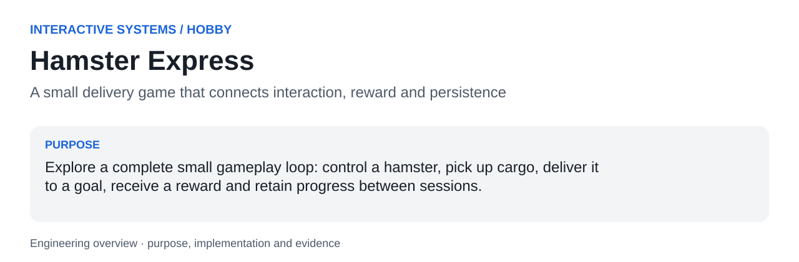
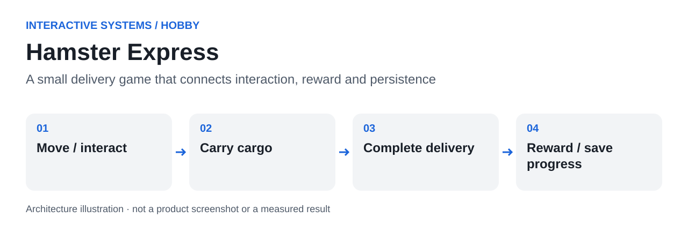

<a id="readme-top"></a>



# Hamster Express

**A small delivery game that connects interaction, reward and persistence.**

Explore a complete small gameplay loop: control a hamster, pick up cargo, deliver it to a goal, receive a reward and retain progress between sessions.

| At a glance | |
|---|---|
| Context | Interactive Systems / Hobby |
| Current evidence | Unreal C++ prototype; editor launch and packaging not reproduced here |
| Stack | Unreal Engine 5.8, C++, Actor/Character classes, HUD, SaveGame, runtime world construction |
| Author | [hupositoc](https://github.com/hupositoc) |

[Case study](docs/case-study.md) · [Architecture](docs/architecture.md) · [Validation](docs/validation.md) · [Design rationale](docs/design-rationale.md)

## Table of Contents

- [About The Project](#about-the-project)
- [Getting Started](#getting-started)
- [Usage](#usage)
- [Roadmap](#roadmap)
- [Contributing](#contributing)
- [License](#license)
- [Contact](#contact)
- [Acknowledgments](#acknowledgments)

## About The Project

### Why I built it

A hobby project built around Unreal Engine C++. It is separate from marine testing and is presented as a prototype rather than a released commercial game.

A game idea becomes useful engineering practice only when its pieces cooperate: movement, interaction state, world layout, feedback, rewards and saved progress. Building those pieces separately without a connected loop would leave a visual scene rather than a playable prototype.

### What I implemented

Use distinct actors for the character, cargo and delivery goal; keep completion/reward logic in the game mode; render messages through the HUD; and serialize player transform and delivery progress through a SaveGame object. Build a simple world at runtime to reduce dependence on external art during the technical prototype stage.

### What this made possible

- Exercise the full pick-up, travel, deliver and reward sequence in one codebase.
- Explore player movement, sprinting and interaction through explicit C++ classes.
- Persist player location, coins and delivery-completion state through manual save/load and completion-triggered saving.

### What happened in practice

The repository contains the connected gameplay classes, a +100 coin completion rule and save/load paths. Source inspection confirms those mechanisms; playability, performance and packaged-build reliability have not been measured in this environment.

### Built With

Unreal Engine 5.8, C++, Actor/Character classes, HUD, SaveGame, runtime world construction. Dependencies provide integration capabilities; the source links below identify the project-specific behavior.

### Engineering decisions

### Finish a small loop before expanding content

One delivery with persistent consequences provides a clearer engineering milestone than a large scene without working interactions.

### Centralize reward rules

The completion guard prevents the same objective from granting repeated rewards through overlap callbacks.

### Use placeholder art deliberately

Runtime primitives keep the technical loop inspectable. They are not presented as final character production art or animation.

### Code to inspect

| Source entry point | Responsibility |
|---|---|
| [`AHEHamsterCharacter::Interact`](Source/HamsterExpress/HEHamsterCharacter.cpp#L148) | Handles player interaction and carrying state. |
| [`AHECargo::Pickup`](Source/HamsterExpress/HECargo.cpp#L34) | Transfers cargo into the player interaction loop. |
| [`AHEDeliveryGoal::OnGoalOverlap`](Source/HamsterExpress/HEDeliveryGoal.cpp#L43) | Detects arrival at a destination. |
| [`AHEGameModeBase::CompleteDelivery`](Source/HamsterExpress/HEGameModeBase.cpp#L37) | Guards duplicate completion, grants coins and saves progress. |
| [`AHEGameModeBase::LoadProgress`](Source/HamsterExpress/HEGameModeBase.cpp#L65) | Restores transform, coin and completion state. |
| [`AHEWorldBuilder::BuildVillage`](Source/HamsterExpress/HEWorldBuilder.cpp#L117) | Constructs part of the prototype environment. |

### AI-assisted engineering

I use AI development tools to turn concrete needs into working software. My engineering responsibilities include defining the problem, interpreting the operating constraints, reviewing behavior, investigating failures and checking results. AI assistance is a development method; it is not evidence that a feature works. File-by-file AI authorship or a specific assistant/model is not claimed without the corresponding development record.

## Getting Started

### Prerequisites

Unreal Engine 5.8, Visual Studio 2022 with C++ game-development tools, Windows SDK, and compatible graphics hardware.

### Installation

```text
git clone https://github.com/hupositoc/hamster-express.git
cd hamster-express
```

Then follow the project-specific path:

```text
Open HamsterExpress.uproject in Unreal Engine 5.8.
Build the C++ modules and press Play.
WASD: move; Shift: sprint; E: interact; F5: save; F9: load.
```

The commands describe the intended setup. See the validation record for which parts were actually executed in the current environment.

## Usage



**Text equivalent:** Move / interact → Carry cargo → Complete delivery → Reward / save progress.

Start by defining the intended input and expected behavior. Save the configuration with the experiment or test session so that an output can be interpreted later. Review exceptions and raw evidence before treating a summary as a final conclusion.

Gameplay class relationships, the duplicate-completion guard, reward value and saved fields were inspected from C++ source. Editor, packaging and runtime tests remain separate tasks.

### Boundaries and known limitations

- The prototype needs Unreal Engine 5.8 and a supported Windows C++ environment.
- No runtime footage, frame-time benchmark or packaged-build test is included.
- Loading resets carrying state; recovery of an in-progress delivery is not a complete inventory system.
- Rendering settings are configuration, not evidence of visual quality or measured GPU performance.

Read the [case study](docs/case-study.md) for the purpose and enabled workflow, and [architecture](docs/architecture.md) for the source-level explanation. The [validation document](docs/validation.md) separates verified checks, author-reported use and pending integration work.

## Roadmap

- [ ] Record a real gameplay capture after an editor build.
- [ ] Test duplicate overlap, save/load and interrupted-delivery cases.
- [ ] Replace placeholders with documented, redistributable art while preserving the loop.

These are planned tasks, not completed capabilities.

## Contributing

Use an issue to describe a reproducible problem, expected behavior, actual behavior and the environment. For a change, keep the scope focused and attach the relevant test or recording. Do not submit private customer data, identifying test captures, credentials or confidential certification documents.

## License

Existing file-level notices and third-party licenses remain in force. A repository-wide open-source license has not been selected for all archived material. Public visibility does not grant rights beyond those existing terms. Documentation structure attribution does not relicense the software.

## Contact

[hupositoc on GitHub](https://github.com/hupositoc) · [Project issues](https://github.com/hupositoc/hamster-express/issues)

## Acknowledgments

The top-level section order follows [Best-README-Template](https://github.com/othneildrew/Best-README-Template), reviewed under its [Unlicense](https://github.com/othneildrew/Best-README-Template/blob/main/LICENSE.txt). All project narratives are written for this implementation. Visual guidance is attributed in [design rationale](docs/design-rationale.md). The broader 50-repository documentation review informs the reading order, source links and evidence presentation; it does not imply endorsement by those projects.


[Engineering decision record](docs/engineering-decisions.md) · [Review of 50 reference repositories](docs/reference-review-50.md)
