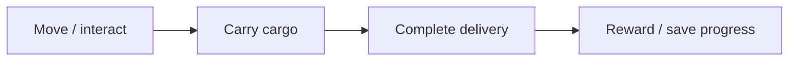

# Architecture and source walkthrough

## System boundary

Use distinct actors for the character, cargo and delivery goal; keep completion/reward logic in the game mode; render messages through the HUD; and serialize player transform and delivery progress through a SaveGame object. Build a simple world at runtime to reduce dependence on external art during the technical prototype stage.

This is a source-derived conceptual diagram, not a captured execution trace. The text equivalent is Move / interact → Carry cargo → Complete delivery → Reward / save progress.

## Source responsibilities

| Source entry point | Responsibility |
|---|---|
| [`AHEHamsterCharacter::Interact`](../Source/HamsterExpress/HEHamsterCharacter.cpp#L148) | Handles player interaction and carrying state. |
| [`AHECargo::Pickup`](../Source/HamsterExpress/HECargo.cpp#L34) | Transfers cargo into the player interaction loop. |
| [`AHEDeliveryGoal::OnGoalOverlap`](../Source/HamsterExpress/HEDeliveryGoal.cpp#L43) | Detects arrival at a destination. |
| [`AHEGameModeBase::CompleteDelivery`](../Source/HamsterExpress/HEGameModeBase.cpp#L37) | Guards duplicate completion, grants coins and saves progress. |
| [`AHEGameModeBase::LoadProgress`](../Source/HamsterExpress/HEGameModeBase.cpp#L65) | Restores transform, coin and completion state. |
| [`AHEWorldBuilder::BuildVillage`](../Source/HamsterExpress/HEWorldBuilder.cpp#L117) | Constructs part of the prototype environment. |

## Design decisions

### Finish a small loop before expanding content

One delivery with persistent consequences provides a clearer engineering milestone than a large scene without working interactions.

### Centralize reward rules

The completion guard prevents the same objective from granting repeated rewards through overlap callbacks.

### Use placeholder art deliberately

Runtime primitives keep the technical loop inspectable. They are not presented as final character production art or animation.

## Input/output contract to preserve

The input configuration must be recoverable alongside the output. Defaults should be treated as this implementation’s starting values, not an external standard. An integration test must check the real host/runtime because an isolated function test cannot establish timing, UI, hardware or external-service behavior.

When modifying the code, identify which responsibility changes: input acquisition, interpretation, persistent state or output presentation. Keep the public behavior and its test evidence together. Avoid silently converting a missing input or failed integration into a successful result.

## Known boundaries

- The prototype needs Unreal Engine 5.8 and a supported Windows C++ environment.
- No runtime footage, frame-time benchmark or packaged-build test is included.
- Loading resets carrying state; recovery of an in-progress delivery is not a complete inventory system.
- Rendering settings are configuration, not evidence of visual quality or measured GPU performance.
